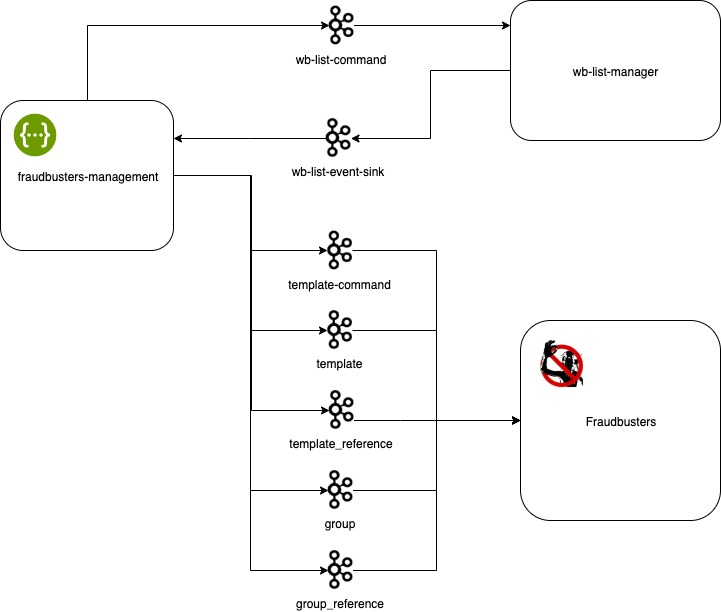

# Fraudbusters Management

Service for managing antifraud patterns and black/white/name lists

Provides a swagger interface for creating, deleting and modifying templates, as well as managing groups and bundles of
patterns. Also provides a swagger interface for creating, deleting and reading black / white / name lists.

### Service Interaction Topology.

The service interacts with fraudbusters and wb-list-manager through the kafka topics using the following protocols,
respectively

- [Fraudbusters Proto](https://github.com/rbkmoney/fraudbusters-proto/blob/master/proto/fraudbusters.thrift)
- [Wb List Proto](https://github.com/rbkmoney/wb-list-proto/blob/master/proto/wb_list.thrift)



### Build

```mvn clean package```

### Start

```java -jar target/fraudbusters-management.jar```

### Link

http://localhost:8080/fb-management/v1/swagger-ui.html#/

### License

[Apache 2.0 License.](/LICENSE)

## Runtime and build

Requires JDK 25. The service uses `service-parent-pom` 4.0.1 (Spring Boot 4.1.0).
Run `mvn clean verify`; integration tests require Docker.
The build starts embedded PostgreSQL for schema generation. If port 5432 is occupied, use `-Ddb.port=55431` (or another free port).

Tracing is supplied by the OpenTelemetry Java agent in the shared Docker runtime.
Configure it using `OTEL_JAVAAGENT_ENABLED`, `OTEL_SERVICE_NAME`,
`OTEL_EXPORTER_OTLP_TRACES_ENDPOINT` and other standard `OTEL_*` variables.
Set `OTEL_METRICS_EXPORTER=none` and `OTEL_LOGS_EXPORTER=none`; service metrics
remain available through Micrometer/Prometheus. Deploy the updated image together
with its Helm environment and entrypoint configuration.
