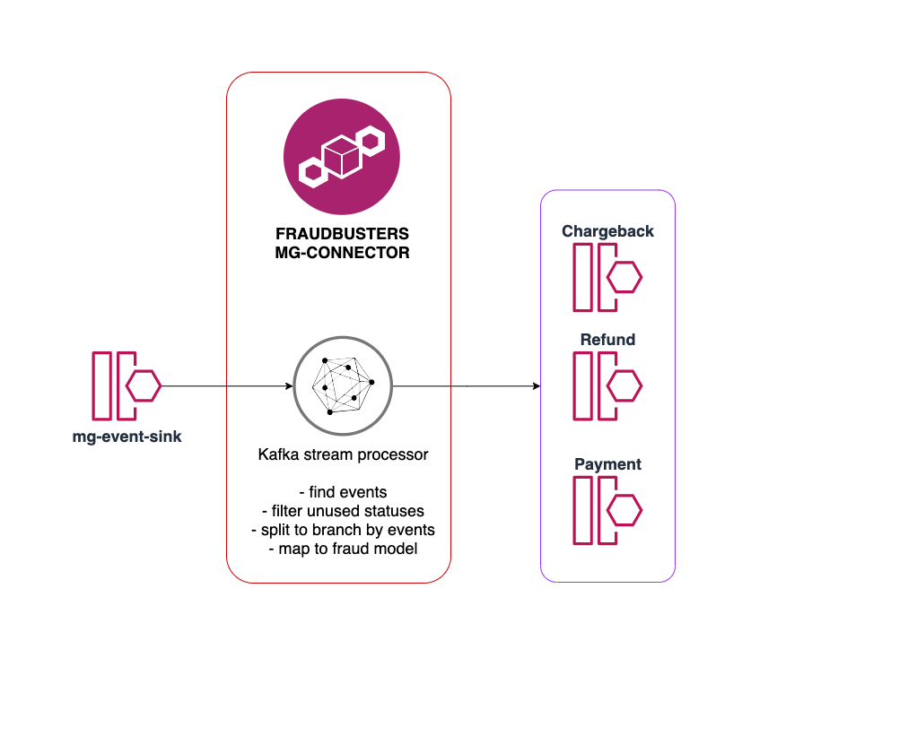

# fraudbusters-mg-connector

Service for stream process mg-event-sink to local fraud model.

#### Stream topic scheme

Service read data from mg-event-sink using protocol [machinegun_proto](https://github.com/valitydev/machinegun_proto/blob/master/proto/event_sink.thrift).
Find need events:
- chargeback (with statuses - accepted, rejected, cancelled)
- refund (with statuses - succeeded, failed)
- payment (with statuses - processed, captured, cancelled, failed)

Map to local fraudbusters model [fraudbusters_proto](https://github.com/valitydev/fraudbusters-proto/blob/master/proto/fraudbusters.thrift) and split to topics by events type

- chargeback
- refund
- payment

## Runtime and build

Requires JDK 25. The service uses `service-parent-pom` 4.0.1 (Spring Boot 4.1.0).
Run `mvn clean verify`; integration tests require Docker.

Tracing is supplied by the OpenTelemetry Java agent in the shared Docker runtime.
Configure it using `OTEL_JAVAAGENT_ENABLED`, `OTEL_SERVICE_NAME`,
`OTEL_EXPORTER_OTLP_TRACES_ENDPOINT` and other standard `OTEL_*` variables.
Set `OTEL_METRICS_EXPORTER=none` and `OTEL_LOGS_EXPORTER=none`; service metrics
remain available through Micrometer/Prometheus. Deploy the updated image together
with its Helm environment and entrypoint configuration.
