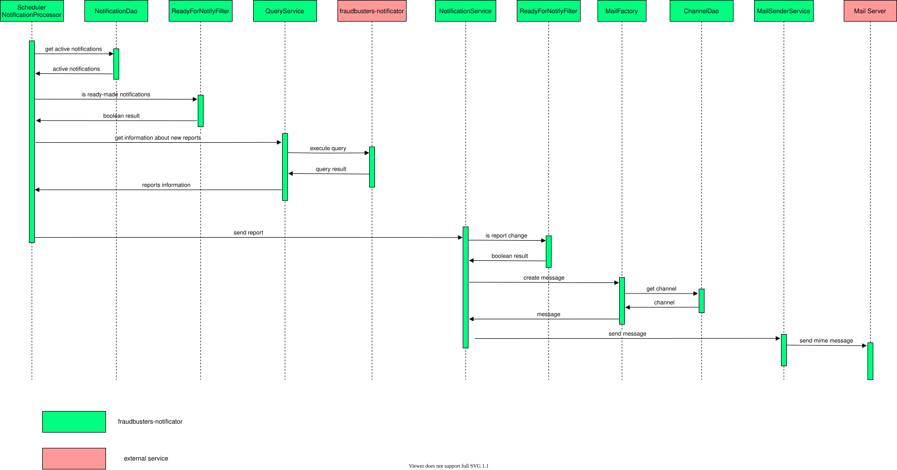

# fraudbusters-notificator

fraudbusters-notificator - сервис предназначен для работы с оповещениями антифрода (Fraudbusters).

В функции сервиса входит:

- управление оповещениями - добавление, изменение, удаление (CRUD)

- управление каналами передачи оповещений

- рассылка настроенных оповещений по выбранным каналам

## Описание работы сервиса

Сервис предоставляет возможность гибко настраивать оповещения и осуществлять их запланированную отправку по различным
каналам. Оповещения строятся на базе шаблонов. Шаблоны оповешений представляют из себя преднастроенную группу
параметров, изменение которых необходимо отслеживать в оповещениях. Для работы с оповещениями необходимо перейти в
раздел "Notifications" системы Fraudbusters.

Общая схема взаимодействия:

Протокол взаимодействия описан [тут](https://github.com/rbkmoney/fraudbusters-notificator-proto).

## Runtime and build

Requires JDK 25. The service uses `service-parent-pom` 4.0.1 (Spring Boot 4.1.0).
Run `mvn clean verify`; integration tests require Docker.
The build starts embedded PostgreSQL for schema generation. If port 5432 is occupied, use `-Ddb.port=55431` (or another free port).

Tracing is supplied by the OpenTelemetry Java agent in the shared Docker runtime.
Configure it using `OTEL_JAVAAGENT_ENABLED`, `OTEL_SERVICE_NAME`,
`OTEL_EXPORTER_OTLP_TRACES_ENDPOINT` and other standard `OTEL_*` variables.
Set `OTEL_METRICS_EXPORTER=none` and `OTEL_LOGS_EXPORTER=none`; service metrics
remain available through Micrometer/Prometheus. Deploy the updated image together
with its Helm environment and entrypoint configuration.
