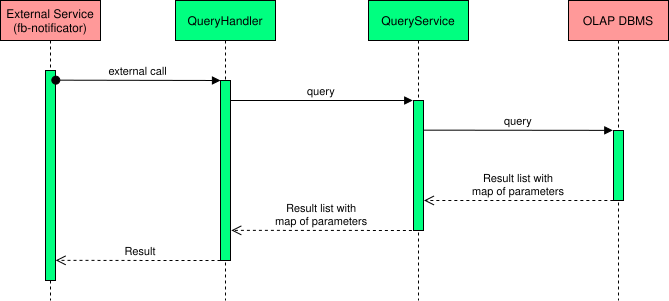

# fraudbusters-warehouse

fraudbusters-warehouse - сервис предназначен для взаимодействия с хранилищем данных системы антифрода (Fraudbusters).

В хранилище присутсвуют следующие данные:

- платежи, прошедшие через процессинг

- результаты работы антифрода

- мошеннические платежи

- чарджбеки и рефанды, осуществленные в результате работы процессинга

## Описание работы сервиса

Сервис является адаптером для взаимодейтсвия с OLAP базой данных. На текущий момент это Yandex Clickhouse. Сервис
принимает на вход текст запроса и список параметров для подстановки в него. Он формирует запрос и вызывает базу данных.
После чего формирует ответ в виде списка полей с их значениями и отдает получившийся результат вызывающему сервису. На
текущий момент с сервивом работает fraudbusters-notificator.

Общая схема взаимодействия:

Протокол взаимодействия описан [тут](https://github.com/vality/fraudbusters-warehouse-proto).

## Runtime and build

Requires JDK 25. The service uses `service-parent-pom` 4.0.1 (Spring Boot 4.1.0).
Run `mvn clean verify`; integration tests require Docker.

Tracing is supplied by the OpenTelemetry Java agent in the shared Docker runtime.
Configure it using `OTEL_JAVAAGENT_ENABLED`, `OTEL_SERVICE_NAME`,
`OTEL_EXPORTER_OTLP_TRACES_ENDPOINT` and other standard `OTEL_*` variables.
Set `OTEL_METRICS_EXPORTER=none` and `OTEL_LOGS_EXPORTER=none`; service metrics
remain available through Micrometer/Prometheus. Deploy the updated image together
with its Helm environment and entrypoint configuration.
